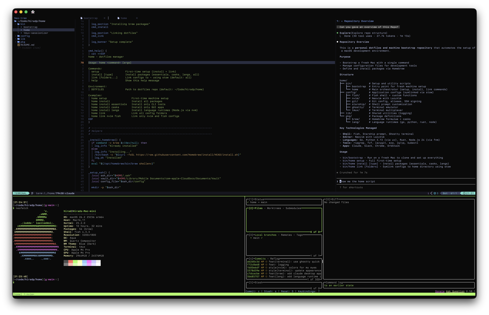

# 🏡 Home

Home is where this repo is cloned & installed.

<p align="center">
  <picture>
    <source media="(prefers-color-scheme: dark)" srcset="assets/dark.png">
    <source media="(prefers-color-scheme: light)" srcset="assets/light.png">
    
  </picture>
</p>

## Quick Start

Sign in to iCloud Drive first and let `Home/vault` download: setup copies the
SSH keys from there and stops without them, since every later clone uses SSH.
Fonts under `Home/fonts` are installed from there too.

```bash
curl -fsSL https://raw.githubusercontent.com/hiradp/home/main/bin/bootstrap | bash
```

To clone the work repo as part of the same run, pass its URL:

```bash
curl -fsSL https://raw.githubusercontent.com/hiradp/home/main/bin/bootstrap | bash -s -- --work <url>
```

What setup cannot do, to finish by hand:

- Install [Rex](https://www.superlogical.com/rex), which `desk` runs on.
- Log in to `gh`, `claude`, `claude-ps`, `codex`, `pi` and `atuin`.
- Authorize the machine's new node on the ZeroTier network.

## Usage

```
home - dotfiles manager

Usage: home <command> [args]

Commands:
  setup [--work <url>]  First-time setup (install + link); --work also clones
                        the work repo from <url> to $WORK_DIR
  install [type]        Install packages (essentials, casks, langs, tools, all)
  link [folders...]     Link configs to ~ using stow (default: all)
  help                  Show this help message
```

Coding agent configuration (Pi, Claude Code, Codex) lives in a separate private repository and is linked automatically by `home setup`.
